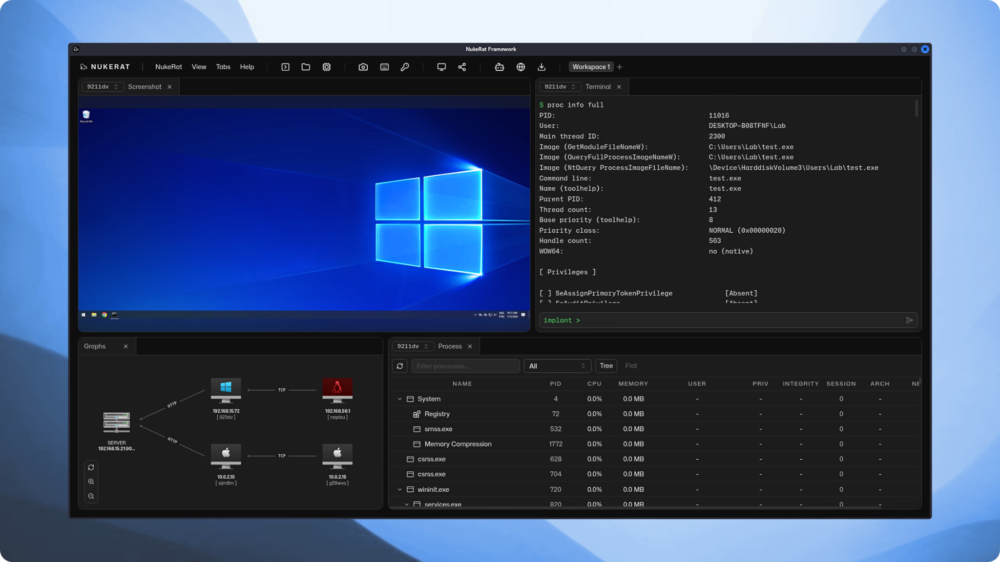
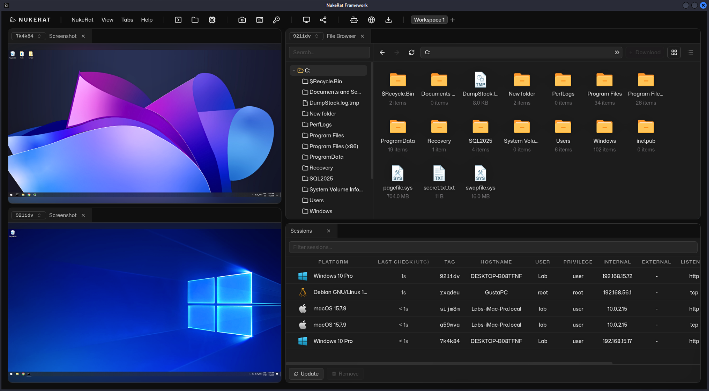
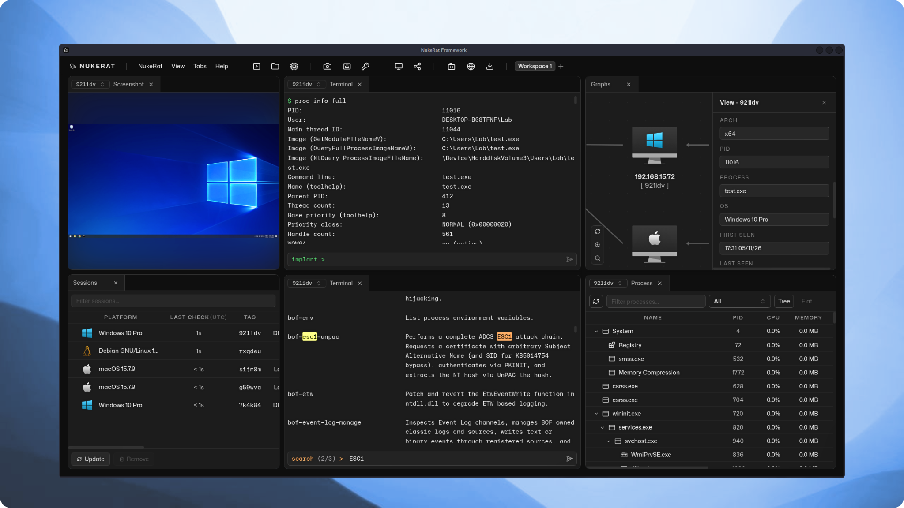

<p align="center">
  <a href="https://nukerat.com">
    
    <h3 style="font-size: 1.7rem;" align="center">NukeRat</h3>
  </a>
</p>

<p align="center">
  Post exploitation framework
</p>

<p align="center">
  <a href="https://nukerat.com/docs"><strong>Documentation</strong></a> ·
  <a href="https://nukerat.com/docs/armory"><strong>Armory</strong></a> ·
  <a href="https://nukerat.com/docs/fast-setup"><strong>Tutorial</strong></a>
</p>

## NukeRat

NukeRat is a post-exploitation framework for advanced Red Team operations, focused on exploiting modern and complex environments. Some of its features and characteristics include:

| Feature | Description |
| --- | --- |
| Armory | +550 adapted BOF and .NET utilities |
| Communication | Custom C2 with external platforms (e.g. Telegram, Discord, etc.) |
| Runtime evasion | Indirect syscalls, stack spoofing, sleep mask, AMSI/ETW patch, etc. |
| Injections | Allocation modes: VirtualAlloc, section, and module stomping |
| LOTL | Living off the Land integration with +240 native Windows binaries (LOLBAS) |
| Static evasion | PE customization |
| Implants | Cross platform: Windows, Linux, macOS (ARM support) |
| Linux | Implants compatible with Linux BOFs |
| AI | Integration with agents (DeepSeek, local, etc.) |
| Reports | Executed commands, IOCs, and compromised hosts |

<br/>

<div align="center">
  <a href=".github/banners/01.png">
    
  </a>
</div>

## Fast setup (linux)
**Installation**
```bash
git clone https://github.com/nukeratframework/nukerat && cd nukerat && sudo bash install.sh all
```
**Create operator key**
```bash
./nukerat.py server key add operator
```
**Server start**
```bash
./nukerat.py server start
```
**Client start**
```bash
./nukerat.py client start
```
For the full fast setup, from installation through implant creation, see [https://nukerat.com/docs/fast-setup](https://nukerat.com/docs/fast-setup).

## Documentation

You can read the full NukeRat documentation at [https://nukerat.com/docs](https://nukerat.com/docs). Available languages:

| Language | Link |
|----------|--------------|
| English | [en-us](https://nukerat.com/docs) |
| Spanish | [es-es](https://nukerat.com/docs?lang=es-es) |
| Korean | [ko-kr](https://nukerat.com/docs?lang=ko-kr) |
| Chinese (Simplified) | [zh-cn](https://nukerat.com/docs?lang=zh-cn) |
| Russian | [ru](https://nukerat.com/docs?lang=ru) |
| Persian | [fa-ir](https://nukerat.com/docs?lang=fa-ir) |
| Japanese | [ja-jp](https://nukerat.com/docs?lang=ja-jp) |


## Gallery

<div align="center">
  <a href=".github/banners/02.png">
    
  </a>

  <br/>

  <a href=".github/banners/03.png">
    
  </a>
</div>

### License (GPLv3)

NukeRat is licensed under [GPLv3](LICENSE). Other licenses in this repo:

- [SGN](server/infra/bin/encoders/sgn/) under MIT (Ege Balcı)
- [Nim crypt utils](implants/linux/stageless/utils/crypt/utils/) under MIT (Eugene Kabanov, adapted from [nimcrypto](https://github.com/cheatfate/nimcrypto)).
- [LOLBAS reference](server/core/utils/messages/lolbins/reference/LOLBAS/) under GPLv3 (upstream LOLBAS dataset)